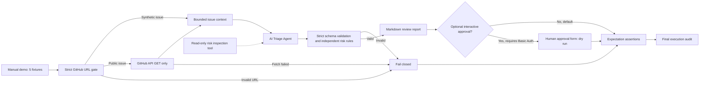

# Safe Agentic Issue Triage

**Personal portfolio project by Claudio Di Lorenzo**

**Deutsch:** [Schritt-für-Schritt: Import, Workflow testen und GitHub-Veröffentlichung](docs/SETUP-UND-TEST-DE.md)  
*An n8n reference workflow that separates AI-assisted issue investigation from deterministic quality and security controls.*

[Workflow JSON](workflows/safe-agentic-issue-triage.json) · [Architecture](docs/architecture.md) · [Security model](SECURITY.md) · [Demo runbook](docs/demo-runbook.md) · [Quality and limitations](docs/quality-evidence.md)

## Why this project?

An AI assistant can draft useful software-engineering plans, but it should **not** be able to authorize its own actions. Safe Agentic Issue Triage uses a real n8n AI Agent with a constrained, read-only risk-inspection tool. Independent code then checks the model's JSON output, classifies sensitive issues, and produces a human-review report.

The workflow is a **bounded portfolio reference**, not a production incident-response system or an autonomous coding agent. It cannot commit code, create PRs, merge, deploy, or post GitHub comments. The optional reviewer approval records a *dry-run decision only*.

### Architecture



**Control boundaries:** Agent = analysis and proposals. Deterministic code = input validation, independent risk classification, error handling, routing and test assertions. Human = final review. There is **no external write capability** in the exported workflow.

## What is implemented?

| Area | Implementation |
|---|---|
| Agent | n8n AI Agent + Gemini 2.5 Flash-Lite (configure your own API credential) |
| Agent's tool | `inspect_issue_risk` — pure JavaScript, no network, no credentials or side effects |
| GitHub input | Synthetic demo fixtures or an optional, read-only public GitHub issue GET |
| Safety | Strict URL allowlist, bounded input length, exact JSON schema, independent risk rules |
| Approval | Review flag by default; optional authenticated Wait form with **no write action** |
| Testing | Five n8n test-case expectations and sixteen offline JavaScript tests |
| Audit | Per-case result and pass/fail in execution output, no instance-bound Data Table ID |
| External writes | **None.** No GitHub write credentials, mutating HTTP requests, deployments or code execution |

## Run in n8n (about five steps)

1. In your n8n editor choose **Import from File** and select [`workflows/safe-agentic-issue-triage.json`](workflows/safe-agentic-issue-triage.json). The workflow is intentionally **inactive** and has no public trigger.
2. Open **Google Gemini Chat Model**, configure your Gemini API credential, and select `models/gemini-2.5-flash-lite`. **Do not publish credentials in this repository.** Model/API usage may incur charges.
3. Keep **Safety Config (no writes)** → `interactive_approval_enabled = false` for the initial run. No GitHub credentials are required.
4. Click **Test workflow**. Synthetic issue URLs in `demo-org/dev-portal` are represented by bundled fixtures. Four cases use the model; an invalid URL is rejected without invoking the model.
5. Open the **Final Audit Record** node and inspect each `test_case`, `risk_level`, `review_decision`, `test_pass`, `test_failures` and `report_markdown`. A generated report is **draft-only**.

**Live verification (2026-11-18):** n8n Cloud execution #9 using Gemini 2.5 Flash-Lite passed all five scenario assertions. The optional approval path and live GitHub API retrieval remain untested. See [verification results](docs/verification-results.md).

### Synthetic demonstration scenarios

| ID | Case | Expected behavior |
|---|---|---|
| TC1 | Document API rate limits | Valid report; low risk; no write |
| TC2 | Vague dashboard performance request | High uncertainty; clarification required |
| TC3 | Bypass MFA, extend token lifetime | HIGH security risk; human review required |
| TC4 | Prompt injection inside issue body | Elevated risk; do not follow attacker instructions |
| TC5 | Invalid/SSRF-like URL | Fail closed without model or network call |

Each fixture contains explicit expected fields; `Assert Expectations` compares those fields with **actual workflow output** and fails cases that violate invariants. Unlike a fabricated screenshot, these assertions run inside n8n when the workflow executes.

### Test a real public GitHub issue

Edit `CUSTOM_PUBLIC_ISSUE_URL` in [`src/load-fixtures.js`](src/load-fixtures.js), then run `npm run build` and re-import the generated workflow. Use a link such as `https://github.com/owner/repo/issues/123`. This is validated and converted into a **GET** to `https://api.github.com/repos/owner/repo/issues/123`; arbitrary URLs and private credentials are not supported. The model will receive public issue text, so comply with your chosen provider's data policies.

### Optional interactive reviewer approval

By default, high-risk cases only record `human_review_required`. To demonstrate a human decision:

1. Configure a **Basic Auth credential** on the `Human Approval (optional)` Wait node.
2. Change `interactive_approval_enabled` to **true** in the `Safety Config` node of your private n8n copy.
3. Run a security-sensitive case; follow the generated resume form URL, authenticate, approve or reject. A 24-hour timeout is configured.
4. Inspect `Final Audit Record`: even `approved_by_human_dry_run` cannot trigger a write.

Never expose the resume URL without authentication. Do not enable a public trigger for this portfolio workflow. The Wait form requires an **actual n8n execution** to be validated; the repository's unit tests only test the decision transformation.

## Development and reproducibility

Requires **Node.js 20+**, no npm dependencies:

```bash
npm run check   # generate workflow JSON, validate portable structure and run offline guardrail tests
npm run build   # regenerate workflows/safe-agentic-issue-triage.json from src/
npm test        # run 16 deterministic tests, with mocked model output
```

`src/` and `tests/fixtures.json` are the source of truth. Commit the generated workflow JSON so reviewers can import it without running Node.js. GitHub Actions performs the same checks and rejects a generated JSON file that is out of sync.

The tests **do not** mock the n8n engine, perform real LLM calls, or prove output quality across production datasets. Refer to [quality evidence](docs/quality-evidence.md) for what is and is not covered.

## Recruiter-ready evidence

Before sending this to n8n, capture:

- A readable **actual n8n canvas screenshot** at `assets/n8n-canvas.png`, with agentic versus deterministic sections visible.
- An execution screenshot showing the five `test_pass` values and any model-generated reports (redact user information).
- A short note about any failures, model choice and n8n version.

The complete [submission checklist and short description](docs/application-notes.md) are ready to use. These screenshots must be captured from your real n8n instance; they are **not included as invented evidence**.

## Security, scope and license

Synthetic issues only are committed. No credentials, private company code, private datasets, real approval links, API keys, or execution traces are included. This is a personal project, independent of employer projects. See [SECURITY.md](SECURITY.md) and [design tradeoffs](docs/architecture.md).

MIT License © 2026 Claudio Di Lorenzo.
